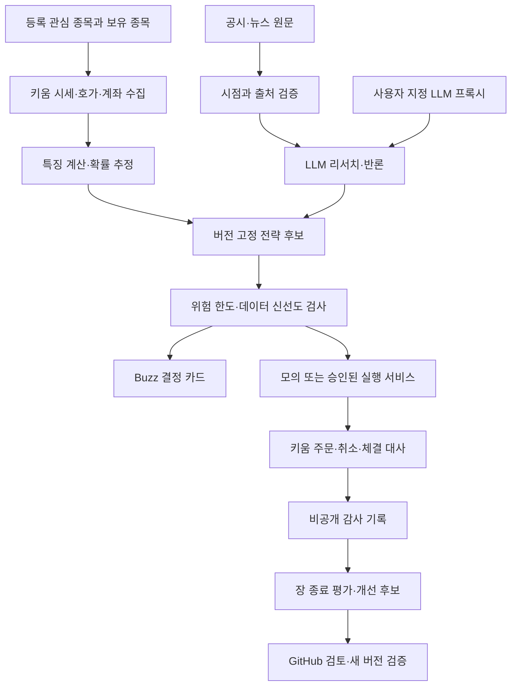

# 단기 매매 시스템 설계

상태: 구현 전 설계 초안. [조사 근거](../research/evidence.md) · [구현 계획](../plans/implementation.md)

## 목적과 범위

사용자가 등록한 관심 종목에서 거래 가능한 후보를 선별하고, 1~2 거래일 보유를 기준으로 분석한다.
국내와 미국의 현물 주식·일반 ETF부터 시작한다. 다른 해외 시장과 달력일 기준 보유는 추가 결정 사항이다.
장중 진입·청산과 익일 보유를 분리해 평가한다. 매일 거래할 의무는 없다. 근거가 약하면 관망한다.
최종 목적은 검증 후 자동 주문이다. 이번 설계 작성은 실계좌 주문을 시작한다는 뜻이 아니다.

확률은 과거 표본에서 측정·보정한 추정값이다. LLM의 자신감이나 에이전트 찬성 비율은 확률로 표시하지 않는다.
손절 주문도 급락·거래정지·유동성 부족 때 손실을 제한한다고 보장할 수 없다.

## 구성

LLM은 연구와 설명을 담당한다. 시세마다 LLM 토론을 다시 하지 않는다.
실시간 프로그램은 고정된 전략과 위험 규칙을 적용한다. Buzz 메시지는 주문 명령으로 직접 실행하지 않는다.
LLM 프록시는 AI 호출 경로이며 증권 데이터 공급원이 아니다. 프록시 장애 때 신규 진입을 멈춘다.
이미 보유한 포지션의 보호·대사 기능은 LLM 및 Buzz와 독립적으로 계속 동작한다.

## 데이터와 실행 환경

Python 서비스는 키움 연결, 데이터 정규화, 전략 계산과 주문 상태를 담당한다.
LLM 연동은 기존 프록시의 호환 API를 사용한다. TypeScript 서비스가 필요하면 기존 llm-gateway를 재사용한다.
SDK를 쓰기 위해 초기부터 별도의 TypeScript 마이크로서비스를 추가하지 않는다.
PostgreSQL은 주문·잔고·의사결정 기록, Parquet과 DuckDB는 연구용 시계열에 사용한다.
초기에는 단일 서버와 Docker Compose를 사용하고, 다중 주문 실행 인스턴스는 금지한다.
서버 위치·Docker context·재시작 정책·시간 동기화는 배포 단계에서 실제로 확인한다.

| 데이터 | 1차 소스 | 검증 조건 |
| --- | --- | --- |
| 종목·시세·호가·체결·잔고 | 키움 REST/WebSocket | 시장별 권한, 호출 제한, 지연, 누락·재연결 복구 |
| 국내 공시 | OpenDART | 기업 ID 매핑, 접수·발표·수집 시각 |
| 미국 공시 | SEC EDGAR | CIK 매핑, 발표 시각, 접근 정책 |
| 뉴스·실적 일정 | 추가 공급자 선정 | 원문 출처, 실제 배포 시각, 라이선스, 중복 기사 |
| 과거 분봉·호가·상장폐지·기업행동 | 키움 범위 확인 후 부족분 구매 | 시점별 종목군, 수정주가, 학습 이용 권한 |
| 환율·시장 달력 | 계약된 데이터 소스 | 미국 서머타임, 휴장·조기 폐장, 통화별 평가 |

종목 키는 거래소·종목 코드·통화로 식별한다. 관심 목록과 실제 보유 목록을 별도로 관리한다.
관심 목록에서 제거해도 보유 포지션의 위험 관리는 끝까지 유지한다.
모든 이벤트에 event_time, received_at, source, schema_version을 저장한다.
공시 정정본과 기업행동은 당시 알려진 정보만 재생할 수 있게 버전 관리한다.

## 후보 선별과 포트폴리오

초기 기본값은 현금 매수만 허용하고 미수·신용·공매도·파생·레버리지/인버스 상품은 제외한다.
등록 종목 중 거래대금, 스프레드, 호가 잔량, 변동성, 상대강도, 이벤트 유무로 후보를 좁힌다.
단일 점수 상위순만으로 매수하지 않고 업종·국가·환율·상관 노출을 함께 제한한다.
실적 발표 직전이나 거래정지·급격한 데이터 이상 종목은 기본적으로 신규 진입을 막는다.
정량 필터 수치는 과거 분포와 거래 비용으로 정하고 시장별로 따로 검증한다.

초기 위험 설정은 최적화 결과가 아닌 보수적인 운용 기본값이다.

| 항목 | 초기 설정 |
| --- | --- |
| 거래당 계획 손실 | 시작 운용자금의 0.5% 이내 |
| 하루 손실 중단 | 시작 운용자금의 1% 이상 |
| 누적 손실 중단 | 시작 운용자금의 5% 이상 |
| 동시 보유 | 최대 2종목 |
| 종목별 투입 | 시작 운용자금의 최대 30% |
| 총 투입 | 시작 운용자금의 최대 60% |
| 합산 계획 손실 | 미체결 신규 주문 포함 1% 이내 |
| 추가 제한 | 손실 만회 물타기·마틴게일·자동 한도 상향 금지 |

일일 손실은 공통 회계일 기준 실현·미실현 손익, 수수료·세금·환율을 합산한다.
회계일은 Asia/Seoul 00:00~24:00로 우선 고정하고 미국 세션별 위험도 별도로 기록한다.
자정이 되어도 기존 포지션의 손실과 누적 손실 제한을 지우지 않는다.
중단 시 신규 진입을 막고 미체결 진입 주문을 취소한다. 보유분은 사전 정의한 보호 정책으로 관리한다.
운용 재개는 원인 확인과 명시적 재개 기록이 있어야 한다. 봇이 스스로 손실 한도를 초기화하지 않는다.

수량은 계획 손실 예산 ÷ (진입가와 손절가 차이 + 주당 예상 왕복 비용)으로 구한다.
그 결과에 현금, 환율, 종목별 한도, 정수 주식·최소 주문 규칙을 적용해 내림한다.
최소 1주가 한도를 넘으면 거래하지 않는다. 손절가를 임의로 좁혀 수량을 맞추지 않는다.
보유 기한 종료에는 청산을 시도하되 거래정지·미체결이면 지연과 노출을 알린다.

## 전략과 확률

첫 전략 후보는 유동성이 충분한 종목의 상대강도·거래량 기반 추세 전략이다.
기준 전략을 먼저 만들고, 가격 예측 모델을 더했을 때 비용 차감 성과가 개선되는지 비교한다.
초기 모델 후보는 단순 분류·회귀 및 트리 모델이다. LLM은 이벤트 추출과 근거 검토에 사용한다.
정확한 다음 가격 하나보다 수익률 분포, 손실 폭, 목표·손절·시간 종료별 결과를 추정한다.

확률의 사건은 ‘허용된 진입 조건으로 체결된 후 최대 2 거래일 내 비용 차감 순손익이 양수’로 정의한다.
미체결은 별도 사건으로 기록한다. 승리·손실·시간 종료와 체결 가능성을 구분한다.
표본 부족·분포 변화·보정 실패 때 확률을 표시하지 않고 `판단 보류`를 반환한다.
단순 승률뿐 아니라 평균 이익·손실과 비용을 반영한 기대값을 계산한다.

가상 예: 이익 확률 55%, 평균 이익 1.5%, 평균 손실 1%, 왕복 비용 0.3%이면
기대값은 0.55×1.5%−0.45×1%−0.3%=0.075%다. 이는 실제 예측값이 아니다.
슬리피지가 0.1% 늘면 기대값이 음수가 되므로 높은 승률만으로 매수하지 않는다.

## 실시간 처리와 주문 안정성

원시 시세는 이벤트마다 처리하고 전략은 1분봉 완료 또는 사전 지정 이벤트 때 평가한다.
연구 보고서는 장 시작 전·종료 후 작성한다. 장중 공시·급변·전략 무효화 때만 추가 토론한다.
초기 목표는 수신 후 위험 검사 p95 1초 이내, 이벤트 후 분석 카드 60초 이내다.
이는 측정할 목표이며 거래소부터 수신까지의 지연이나 LLM 응답 시간을 보장하지 않는다.
데이터 나이가 시장별 허용치를 넘거나 호가가 없으면 신규 주문을 막는다.

주문은 단일 실행 서비스만 보낸다. 전략 ID·버전·계좌·종목·신호 시각으로 내부 중복 키를 만든다.
주문 전 의도를 DB에 기록하고 동시 요청을 잠근다. 브로커의 멱등성 지원을 가정하지 않는다.
전송 timeout은 실패로 단정하지 않고 UNKNOWN으로 기록한 뒤 주문·체결을 조회한다.
확정 전 재전송하지 않는다. 부분 체결, 취소와 체결의 경합, 정정 거절을 테스트한다.
재시작 시 미체결·체결·보유·주문 가능 금액을 대사한 후에만 신규 주문을 허용한다.

인증 실패·시세 단절·DB 장애·잔고 불일치·손실 한도 초과는 신규 진입을 차단한다.
손절 주문의 시장별 지원 유형을 확인한다. 서버 내부 손절만 가능하면 프로세스 장애 시 보호가 사라짐을 표시한다.
비상 정지와 수동 HTS/MTS 복구 절차를 제공한다. 장애 때 무조건 시장가 청산하는 규칙은 넣지 않는다.

## Buzz 에이전트와 토론

표시 이름은 `GON-STOCK · 역할`, slug는 `gon-stock-역할`로 고정한다.
기존 에이전트 이름·권한을 변경하지 않고 실제 identity ID와 모델 매핑을 별도 등록한다.

| 역할 | 모델 계획 | 책임 |
| --- | --- | --- |
| 총괄·전략 | Codex Astra 후보 | 근거 통합, 후보 전략과 결정 카드 작성 |
| 독립 반론·리뷰 | Claude Fable 5.2 지정 | 잘못된 가정, 손실 시나리오, 구현·설계 검토 |
| 리서치 | Argon 후보, 평가 후 선택 | 공시·뉴스 원문과 반대 증거 조사 |
| 정량·위험 | 결정론적 코드, 총괄이 설명 | 확률 보정, 노출·한도 검사, 주문 허용 판정 |

모든 LLM 요청은 사용자 지정 프록시를 통한다. 이름만으로 실제 모델 ID를 추측하지 않는다.
모델 목록 조회와 최소 실제 요청의 반환 모델을 확인하고 요청·반환 모델·지연·토큰·실패를 기록한다.
프록시 alias가 바뀌면 재평가한다. Fable 5.2를 사용할 수 없으면 다른 리뷰 모델로 대체하지 않는다.
현재 최고 모델은 미확정이다. 같은 시점의 정보 묶음으로 출처 정확성·반론 품질·구조화 성공·지연을 비교한다.
평가 비용과 운영 복잡성이 증가하므로 모든 종목에 세 모델을 상시 호출하지 않는다.

채널은 private `gon-stock-research`(토론), `gon-stock-signals`(최종 카드),
`gon-stock-ops`(상태·장애) 세 개를 계획한다. 공개 GitHub와 거래 채널 공개 여부는 별개다.
토론은 제안→독립 반론→보완→판정으로 최대 2회 보완한다. 합의가 안 되면 관망한다.
원문 URL·발표 시각·데이터 버전·반증 조건을 필수로 남긴다. 무한 에이전트 상호 호출을 차단한다.
LLM에는 키움 비밀값과 직접 주문 도구를 주지 않는다. 외부 뉴스의 명령문은 데이터로만 취급한다.

결정 카드는 종목·시장·기준시각·유효기한·전략 버전·행동(매수 후보/보유/청산 후보/관망),
진입 구간·손절·목표·최대 보유·추정 확률과 표본·기대손익·핵심 근거·반대 근거·무효화 조건을 담는다.
개인 계좌 금액·수량은 비공개 화면에서만 표시한다. 유효기간 만료 카드는 주문에 재사용하지 않는다.

## 검증과 예측 실패 개선

시간순 학습·검증·최종 평가를 분리하고 보유기간이 겹치는 표본 사이에 purge/embargo를 적용한다.
종목 생존편향, 미래 공시, 정정 재무정보, 수정주가 누출을 차단한다.
분봉 안에 손절과 목표가가 모두 있으면 유리한 순서를 가정하지 않는다. 세부 데이터 없이는 보수적으로 평가한다.
수수료·세금·환전·스프레드·슬리피지·미체결·지연·가격 제한·기업행동을 반영한다.
순기대값, 최대낙폭, 손익비, 거래 수, Brier score와 신뢰도 구간을 시장·국면별로 보고한다.
반복 실험 횟수와 탈락한 전략도 남겨 가장 좋은 백테스트만 선택하는 편향을 드러낸다.

장 종료 후 실패를 데이터/예측/체결/운영/정상 확률적 손실로 분류한다.
실패 거래마다 모델을 즉시 재학습하지 않는다. 주기별 후보를 shadow로 비교하고 개선이 검증된 버전만 승격한다.
코드·데이터 해시·모델·프롬프트·매개변수를 함께 고정한다. 성과 악화 시 이전 버전 또는 관망으로 복귀한다.
운영비 포함 순손익과 거래비용만 차감한 손익을 둘 다 기록한다.

## 공개 정보와 미결정 사항

공개 GitHub에는 개인 운용금·계좌·보유·프록시 주소·Buzz identity·시세 원문을 넣지 않는다.
필요한 값은 제외된 로컬 설정과 안전한 인증 저장소에서 제공한다.
실거래 기록은 접근 제한된 저장소에 보관하고 GitHub에는 익명 요약·검증 해시만 게시한다.
외부 모델에 보낼 원문은 제공 계약과 데이터 사용 조건을 확인한다.

남은 결정은 해외 시장 범위, 보유기간의 거래일 기준, 초기 관심 종목,
실적 발표·야간 보유 허용 여부, 운영 서버, Buzz 대상 relay, 실제 모델 매핑이다.
현재 기본안은 국내·미국, 2 거래일 이내, 정규장 주문, 실적 발표 통과 보유 금지다.
